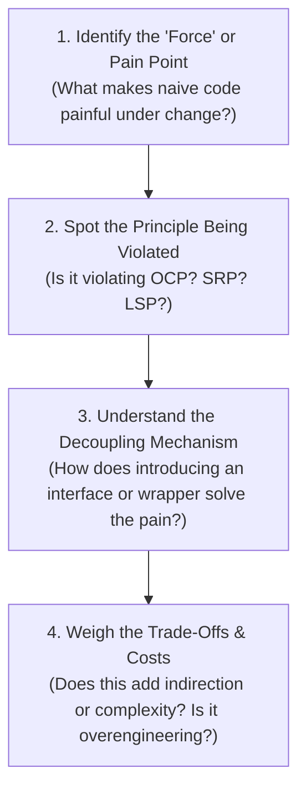

# How to Study Design Patterns for True Retention

Design patterns are not static code templates to be memorized; they are **proven architectural solutions to recurring software engineering problems**.

---

## The 4-Step Mental Model for Every Pattern

When reviewing any pattern in this repository, run through this four-step sequence:

---

## The Anti-Pattern of Memorization

❌ **Wrong Way to Study**:
- "I need to memorize the 6 classes that make up Abstract Factory so I can draw the exact same diagram in an interview."
- *Result*: As soon as an interviewer tweaks the problem (e.g. *"What if products can be dynamically registered via config files?"*), memorized solutions fall apart.

✅ **The First-Principles Way**:
- "Abstract Factory exists because I need to create **entire families of related products** (e.g., Windows Buttons + Windows Menus) without hardcoding concrete platform classes in my client."
- "If I add a Mac platform, I only create a `MacFactory` implementing `IUIFactory`—my client code never changes (satisfying the Open/Closed Principle)."

---

## The "When NOT to Use It" Rule (YAGNI)

A design pattern adds:
- More classes and files
- An extra layer of indirection (vtable lookup overhead, pointer indirection)
- Higher cognitive load for readers

> **Rule of Thumb**: Do not apply a design pattern until you have at least **two concrete variations** or an explicit requirement for future extension. Refactor *towards* patterns as the system evolves; do not start with premature abstractions.

