# Gang of Four (GoF) Pattern Classification

In 1994, Erich Gamma, Richard Helm, Ralph Johnson, and John Vlissides (the "Gang of Four") published *Design Patterns: Elements of Reusable Object-Oriented Software*, formalizing **23 foundational design patterns**.

---

## The Three High-Level Categories

```mermaid
graph TD
    GoF["GoF 23 Design Patterns"]
    GoF --> Creational["1. Creational (5 Patterns)<br>Object Instantiation & Lifecycle"]
    GoF --> Structural["2. Structural (7 Patterns)<br>Class & Object Composition"]
    GoF --> Behavioral["3. Behavioral (11 Patterns)<br>Object Communication & Algorithms"]

    Creational --> C1["Singleton"]
    Creational --> C2["Factory Method"]
    Creational --> C3["Abstract Factory"]
    Creational --> C4["Builder"]
    Creational --> C5["Prototype"]

    Structural --> S1["Adapter"]
    Structural --> S2["Bridge"]
    Structural --> S3["Composite"]
    Structural --> S4["Decorator"]
    Structural --> S5["Facade"]
    Structural --> S6["Flyweight"]
    Structural --> S7["Proxy"]

    Behavioral --> B1["Chain of Responsibility"]
    Behavioral --> B2["Command"]
    Behavioral --> B3["Interpreter"]
    Behavioral --> B4["Iterator"]
    Behavioral --> B5["Mediator"]
    Behavioral --> B6["Memento"]
    Behavioral --> B7["Observer"]
    Behavioral --> B8["State"]
    Behavioral --> B9["Strategy"]
    Behavioral --> B10["Template Method"]
    Behavioral --> B11["Visitor"]
```

---

## Classification by Scope: Class vs. Object

Patterns also differ by whether they operate on **classes** (static compile-time relationships via inheritance) or **objects** (dynamic runtime relationships via pointers/references):

| Category | Class Scope (Inheritance) | Object Scope (Composition & Delegation) |
|---|---|---|
| **Creational** | Factory Method | Abstract Factory, Builder, Prototype, Singleton |
| **Structural** | Class Adapter | Object Adapter, Bridge, Composite, Decorator, Facade, Flyweight, Proxy |
| **Behavioral** | Interpreter, Template Method | Chain of Resp, Command, Iterator, Mediator, Memento, Observer, State, Strategy, Visitor |

> **Key Takeaway**: Modern C++ heavily favors **Object Scope** patterns because composition provides runtime flexibility and decouples classes from concrete inheritance trees.

