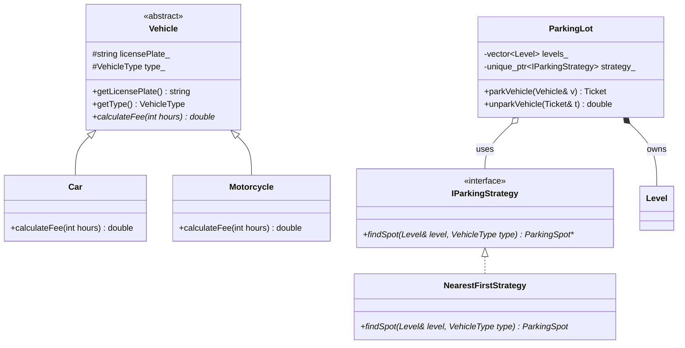
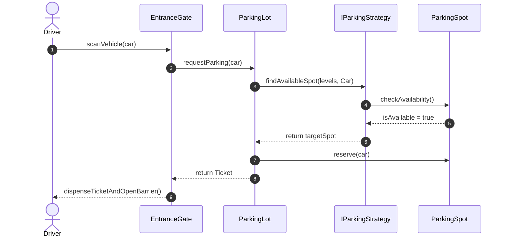

# UML Class & Sequence Diagrams Reference

In Low-Level Design interviews and technical documentation, UML (Unified Modeling Language) allows you to visually communicate class hierarchies, dependencies, and execution lifecycles without getting bogged down in syntax.

---

## 1. Class Relationships Visual Matrix

| Relationship | Symbol (Mermaid) | Description | Lifecycle Coupling | Example |
|---|:---:|---|---|---|
| **Inheritance** | `A <|-- B` | `B` is-a `A`. Base class specialization. | Very High (Compile-time) | `Car` is-a `Vehicle` |
| **Realization** | `Interface <\|.. Impl` | Class implements an abstract interface. | Moderate (Decoupled) | `SmtpNotifier` implements `INotifier` |
| **Composition** | `Whole *-- Part` | Strong ownership. If Whole dies, Part dies. | Very High | `Car` owns its `Engine` |
| **Aggregation** | `Container o-- Item` | Weak ownership / Has-a. Item can outlive Container. | Low to Moderate | `Department` has `Employees` |
| **Association** | `A --> B` | Structural link. `A` holds a reference/pointer to `B`. | Low | `Customer` books `Ticket` |
| **Dependency** | `A ..> B` | Ephemeral use. `A` uses `B` as a local variable/parameter. | Very Low | `Calculator` uses `MathHelper` |

---

## 2. Mermaid Class Diagram Example



---

## 3. Sequence Diagram Example (Booking Flow)

Visualizes the temporal message ordering between actors and objects:



---

## 4. ASCII Notation for Whiteboard Interviews

During live coding or text-only interviews, use standardized ASCII box notations:

```text
+---------------------------------------+
|              <<interface>>            |
|            IPaymentProcessor          |
+---------------------------------------+
| + pay(amount: double): bool           |
| + refund(txnId: string): bool         |
+---------------------------------------+
                   ^
                   | implements
      +------------+------------+
      |                         |
+---------------+       +---------------+
|  StripeGateway|       |  PayPalGateway|
+---------------+       +---------------+
| - apiKey      |       | - oauthToken  |
+---------------+       +---------------+
| + pay(...)    |       | + pay(...)    |
+---------------+       +---------------+
```

