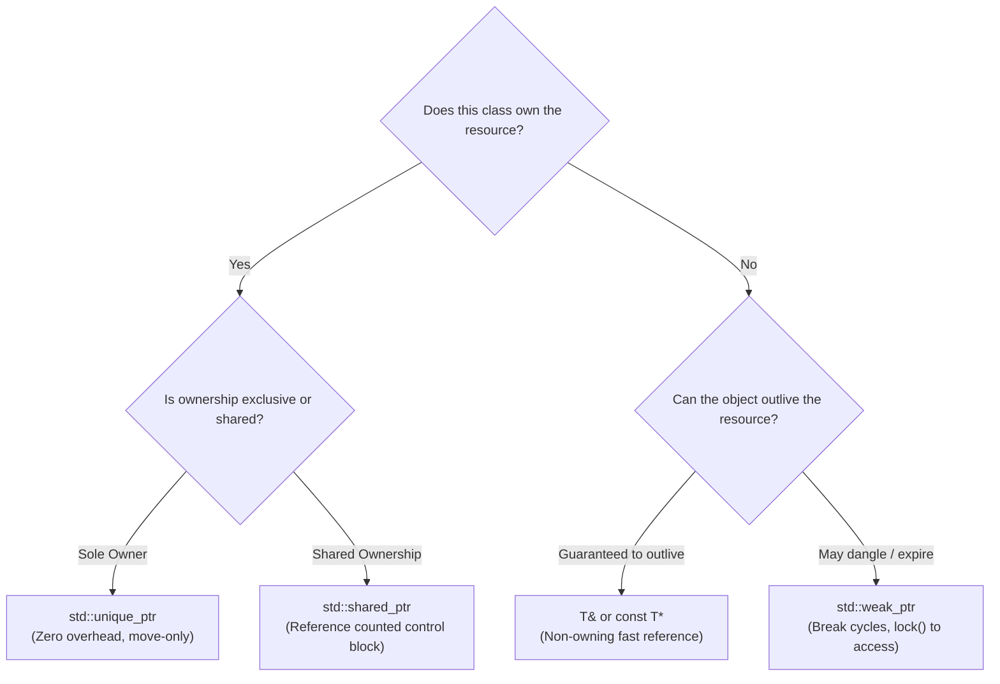

# Object Ownership and Lifetime in Modern C++

The fundamental difference between Low-Level Design in Java/Python and C++ is **deterministic object lifetime and explicit ownership semantics**. Modern C++ eliminates garbage collection pauses and raw pointer bugs through RAII and smart pointers.

---

## The Ownership Decision Matrix



---

## 1. `std::unique_ptr<T>`: Sole, Exclusive Ownership

- **Cost**: Zero runtime overhead (identical to a raw pointer in size and speed).
- **Semantics**: Move-only (`std::move`). Cannot be copied.
- **Rule of Thumb**: Default to `std::unique_ptr<T>` for all owned polymorphic pointers in design patterns (Factories, Strategies, States).

```cpp
#include <memory>
#include <iostream>

class Widget {
public:
    void doWork() { std::cout << "Working...\n"; }
};

void processWidget(std::unique_ptr<Widget> w) {
    // Ownership transferred here; w destroyed at the end of this function
    w->doWork();
}

int main() {
    auto w = std::make_unique<Widget>();
    // processWidget(w); // COMPILE ERROR: Cannot copy unique_ptr!
    processWidget(std::move(w)); // OK: Explicit ownership transfer
    // w is now nullptr here
}
```

---

## 2. `std::shared_ptr<T>`: Shared Ownership

- **Cost**: Control block allocation (two atomic counters: use_count and weak_count). Thread-safe reference counting.
- **Rule of Thumb**: Use ONLY when multiple objects genuinely co-own a resource and no single object can be designated the lifetime owner (e.g. shared graph nodes, caches, event subscribers).

```cpp
auto sharedNode = std::make_shared<Node>(42);
std::cout << "Ref count: " << sharedNode.use_count() << "\n"; // 1
auto anotherOwner = sharedNode;
std::cout << "Ref count: " << sharedNode.use_count() << "\n"; // 2
```

---

## 3. `std::weak_ptr<T>`: Non-Owning Observer & Cycle Breaker

- **Cost**: Observes a `std::shared_ptr` without incrementing its `use_count`.
- **Primary Use Cases**:
  1. **Circular references** (e.g., Parent owns Children via `std::shared_ptr`; Child points to Parent via `std::weak_ptr`).
  2. **Observer Pattern**: Subject holds `std::weak_ptr<IObserver>` so subjects don't artificially keep dead observers alive.
  3. **Caches**: In-memory cache holding weak references to let unreferenced items be reclaimed.

```cpp
class Observer;

class Subject {
    std::vector<std::weak_ptr<Observer>> observers_;
public:
    void notify() {
        for (auto it = observers_.begin(); it != observers_.end();) {
            if (auto locked = it->lock()) { // Convert weak_ptr to shared_ptr safely
                locked->onNotify();
                ++it;
            } else {
                it = observers_.erase(it); // Observer was deleted, clean up dead slot
            }
        }
    }
};
```

---

## 4. Passing Pointers in LLD Interfaces

| Function Signature | Meaning / Intent | Best Used When |
|---|---|---|
| `void foo(const T& x)` | Non-owning, read-only observation. Object must exist and cannot be null. | Default for passing inputs. |
| `void foo(T* x)` | Non-owning optional reference. May be `nullptr`. | Optional observer parameter. |
| `void foo(std::unique_ptr<T> x)` | Consumes and takes sole ownership of `T`. | Sink functions, factory consumers. |
| `void foo(std::shared_ptr<T> x)` | Shares ownership. Increments atomic ref count. | Storing ownership in another long-lived structure. |
| `void foo(const std::shared_ptr<T>& x)` | Observes a shared object without modifying ref count. | Temporary inspection of a shared resource. |

---

## 5. Modern C++ Smart Pointer Idioms for LLD

1. **Always use `std::make_unique` and `std::make_shared`**:
   - Exception-safe (prevents leaks if another argument throws).
   - Single memory allocation for both control block and object with `std::make_shared`.
2. **Never call `delete` explicitly**:
   - If you write `delete`, you broke RAII. Use smart pointers or custom deleters.
3. **Interfaces must have `virtual ~Interface() = default;`**:
   - Deleting a derived class through a base class pointer without a virtual destructor results in **Undefined Behavior**.

