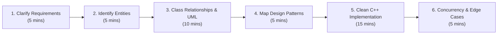

# The 45-Minute Low-Level Design Interview Playbook

Low-Level Design (Machine Coding / Object-Oriented Design) interviews test your ability to convert ambiguous business requirements into **clean, modular, extensible, and thread-safe C++ code** within 45 to 60 minutes.

---

## ⏱️ The 6-Step Interview Framework



---

## Step 1: Requirements Gathering (5 Minutes)
Never jump straight into writing classes. Always ask clarifying questions to bound the scope.

### Essential Questions to Ask
1. **Scale & Capacity**:
   - *"Is this system running as a single-process in-memory application, or interacting with a persistent database?"* (In 95% of LLD rounds, it's in-memory).
2. **Actor Scope**:
   - *"Who are the primary actors interacting with the system?"* (e.g., Customer, Admin, System Scheduler).
3. **Core Use Cases vs Out-of-Scope**:
   - Separate must-have MVP features from good-to-have features:
   - **Must-Have (In Scope)**: Book a parking ticket, calculate fees, assign closest slot.
   - **Out of Scope**: Payment gateway integration, push notifications, GPS navigation.

---

## Step 2: Define Core Entities & Enums (5 Minutes)
Extract the nouns from the requirements.

- **Nouns $\rightarrow$ Classes/Entities**: `Vehicle`, `ParkingSpot`, `Ticket`, `ParkingLot`, `PaymentReceipt`.
- **States / Categories $\rightarrow$ `enum class`**:
  ```cpp
  enum class VehicleType { Motorcycle, CompactCar, LargeTruck };
  enum class SpotStatus { Available, Occupied, Reserved, OutOfService };
  enum class PaymentMethod { Cash, CreditCard, UPI };
  ```

---

## Step 3: Establish Class Relationships (10 Minutes)
Determine how classes collaborate:
- **Association**: `Ticket` refers to `Vehicle`.
- **Aggregation**: `ParkingLot` has multiple `Level`s (can exist independently).
- **Composition**: `Level` owns `ParkingSpot`s (spots die when level is destroyed).
- **Inheritance**: `Motorcycle` is-a `Vehicle`.

Sketch an ASCII or whiteboard class diagram:
```text
+---------------+        1:N        +---------------+        1:N        +---------------+
|  ParkingLot   | <---------------- |     Level     | <---------------- |  ParkingSpot  |
+---------------+                   +---------------+                   +---------------+
        |                                                                       |
        | assigns                                                               | holds
        v                                                                       v
+---------------+                   +---------------+                   +---------------+
|    Ticket     | ----------------> |    Vehicle    |                   |  VehicleType  |
+---------------+                   +---------------+                   +---------------+
```

---

## Step 4: Map Requirements to Design Patterns (5 Minutes)
Avoid forcing patterns where they don't belong. Justify each pattern before writing code:

| Requirement Need | Pattern | C++ Justification |
|---|---|---|
| Need different parking allocation rules (closest to entrance vs random) | **Strategy Pattern** | Inject `IParkingStrategy` into `ParkingLotManager`. |
| Creating different vehicles or spots based on input strings | **Factory Method** | Encapsulate instantiation logic. |
| Fee calculation based on hours, dynamic surge, and discounts | **Decorator Pattern** | Wrap base fee calculation with extra charges. |
| Thread-safe single point of access for configuration | **Meyers' Singleton** | Thread-safe static initialization in C++11/17. |
| Object state transitions (e.g. Vending Machine or Order state) | **State Pattern** | Eliminate messy switch-case ladders. |

---

## Step 5: Clean Modern C++ Implementation (15 Minutes)
Write idiomatic, modular C++ code:
1. **Header-First / Interface-First**: Declare interfaces (`virtual ~Interface() = default;`) and models first.
2. **Use Smart Pointers**: Use `std::unique_ptr` for exclusive ownership, `std::string_view` for string parameters, and `const &` for non-owning access.
3. **Keep Methods Focused**: Obey SRP. Methods should do one thing well.
4. **Write a Minimal `main()` Driver**: Demonstrate the complete end-to-end flow with sample inputs and outputs.

---

## Step 6: Concurrency & Edge Cases (5 Minutes)
Top tier companies (Google, Uber, Amazon, Meta) always ask about thread safety:
- **Race Conditions**: *"What happens if two drivers try to book the same parking spot simultaneously?"*
  - **Solution**: Protect critical sections with `std::mutex` or `std::shared_mutex` (reader-writer lock).
  - Use `std::lock_guard` or `std::unique_lock` (RAII locks).
- **Resource Exhaustion**: *"What if the lot is full?"*
  - Throw clear custom exceptions or return `std::optional<Ticket>`.

---

## Scoring Rubric Used by Interviewers

| Evaluation Dimension | Weight | What Interviewers Look For |
|---|:---:|---|
| **Working Code & Flow** | 30% | Does the code compile? Does the driver simulate the core flow cleanly? |
| **Object-Oriented Design & SOLID** | 25% | Extensibility, clean interfaces, proper decoupling, zero God classes. |
| **C++ Mastery & Idioms** | 20% | Proper smart pointers, RAII, const-correctness, no memory leaks. |
| **Edge Cases & Concurrency** | 15% | Handling null inputs, empty collections, thread-safety awareness. |
| **Communication & Justification** | 10% | Explaining *why* design choices were made clearly and concisely. |

