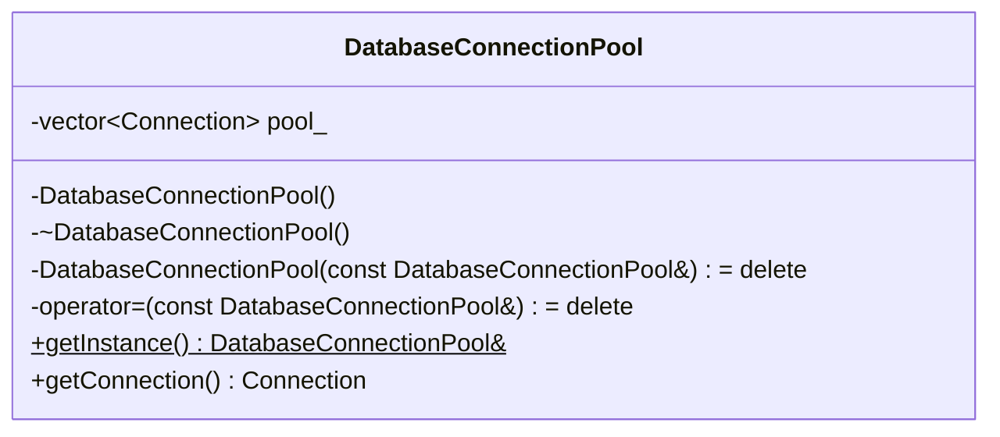

# Singleton Design Pattern in Modern C++

> **Classification**: Creational Pattern | **Scope**: Object

---

## 1. Intent & Real-World Motivation

The **Singleton Pattern** ensures that a class has **only one instance** and provides a **global point of access** to that instance.

### Real-World Analogy
Think of the **Central Bank** or the **Government of a country**. While millions of citizens (clients) interact with economic or regulatory services, there is only one official central bank managing the currency supply. Creating multiple independent central banks would lead to state conflicts and economic chaos.

### In Software Systems
Singletons are used when coordinating a shared resource where having multiple instances causes bugs, state corruption, or resource exhaustion:
- Hardware access (e.g. Printer Spooler, Serial Port Controller).
- Centralized configuration manager.
- Log file managers (where multiple writers must serialize writes to one file).
- Database connection pools.

---

## 2. Naive Approach (The Anti-Pattern)

### The Flawed Code
The classic C++98 implementation using raw pointers and naive lazy initialization:

```cpp
// ❌ DANGEROUS: Classic C++98 Naive Singleton
class NaiveDatabaseConnection {
private:
    static NaiveDatabaseConnection* instance_;
    NaiveDatabaseConnection() = default;

public:
    static NaiveDatabaseConnection* getInstance() {
        if (instance_ == nullptr) { // ❌ RACE CONDITION!
            instance_ = new NaiveDatabaseConnection(); // ❌ MEMORY LEAK! (Never deleted)
        }
        return instance_;
    }
};
NaiveDatabaseConnection* NaiveDatabaseConnection::instance_ = nullptr;
```

### Why It Fails
1. **Critical Race Condition**: If two threads execute `if (instance_ == nullptr)` simultaneously when `instance_` is null, both will evaluate to true and instantiate two separate instances.
2. **Resource Leak**: The memory allocated with `new` is never deallocated (`delete` is never called), preventing clean shutdown and leaking OS file/socket handles.
3. **Double-Checked Locking Trap**: Pre-C++11 attempts to fix this with raw mutexes and double-checked locking were broken due to CPU instruction reordering and missing memory fences.

---

## 3. Architecture & UML



---

## 4. The Idiomatic Modern C++ Solution (Scott Meyers' Singleton)

In C++11 and later (§6.7 [stmt.dcl]), the C++ standard guarantees:
> *"If control enters the declaration concurrently while the variable is being initialized, the concurrent execution shall wait for completion of the initialization."*

This means a **function-local static variable is guaranteed to be initialized thread-safely without manual locking**!

```cpp
class DatabasePool {
private:
    // 1. Private constructor & destructor
    DatabasePool() { /* Initialize connections */ }
    ~DatabasePool() = default;

public:
    // 2. Delete copy and move operations
    DatabasePool(const DatabasePool&) = delete;
    DatabasePool& operator=(const DatabasePool&) = delete;
    DatabasePool(DatabasePool&&) = delete;
    DatabasePool& operator=(DatabasePool&&) = delete;

    // 3. Thread-safe global access point
    static DatabasePool& getInstance() {
        static DatabasePool instance; // Initialized lazily & thread-safely!
        return instance;
    }
};
```

---

## 5. Classic GoF vs Modern C++ Comparison

| Dimension | Classic GoF (C++98) | Modern C++ (C++17) |
|---|---|---|
| **Instantiation** | Heap allocation (`new`) | Static local object (Meyers' Singleton) |
| **Thread Safety** | Manual `std::mutex` / broken DCLP | Guaranteed by language standard |
| **Destruction** | Often leaked or complex `atexit` hooks | Automatically called on program termination |
| **Testability** | Hard to mock (tight coupling) | Abstract base interface + Dependency Injection |

---

## 6. Trade-offs & When NOT to Use

### Disadvantages & Code Smells
- **Hidden Dependencies**: Classes calling `Singleton::getInstance()` inside their methods hide their true dependencies from callers, making unit testing difficult.
- **Global Mutable State**: If the singleton holds mutable state, tests become order-dependent and unit tests cannot run cleanly in parallel.

### How to Make Singletons Testable: Interface Extraction
Instead of client classes hardcoding `DatabasePool::getInstance()`, have them accept an `IDatabasePool&` parameter via constructor injection, passing the Singleton instance as the default argument.

---

## 7. Interview Traps & Follow-Up Questions

1. **Q: Why does the compiler guarantee thread safety for static local variables?**
   - **A**: The compiler emits an internal guard variable (like `__cxa_guard_acquire` and `__cxa_guard_release`) around the static initialization. The first thread acquires the lock, performs the constructor, and sets the guard byte; subsequent threads see the guard byte and skip initialization.
2. **Q: Can you inherit from a Singleton?**
   - **A**: Generally no, because the constructor is private. If you make it `protected`, derived classes could instantiate multiple instances, defeating the pattern.
3. **Q: How does `std::call_once` differ from Meyers' Singleton?**
   - **A**: `std::call_once` with `std::once_flag` allows thread-safe lazy initialization of any callable or pointer, which is useful when dynamic runtime arguments are needed during initialization.

