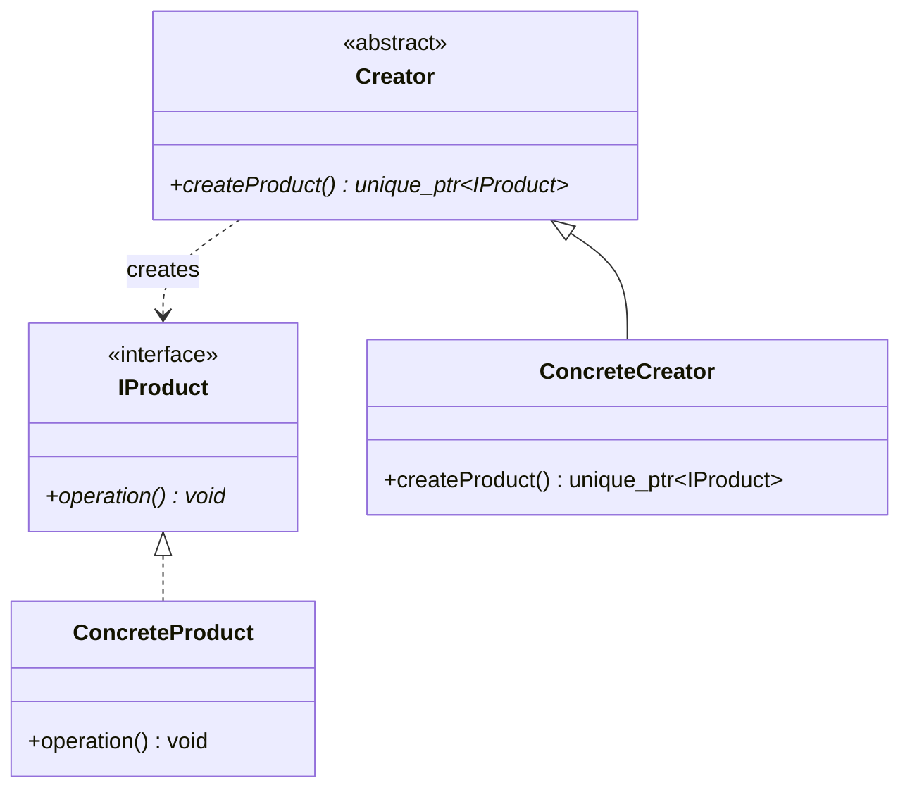

# Factory Method Design Pattern

> **Category**: Creational | **Scope**: Class/Object

---

## 1. Intent
Defines an interface for creating an object, but lets subclasses decide which class to instantiate. In modern C++, this is implemented as a function returning std::unique_ptr<Interface>.

---

## 2. Real-World Analogy
Think of ordering at a fast-food restaurant or using a document creation tool: you specify the high-level request, and the factory or builder handles assembling the concrete components.

---

## 3. Architecture & UML

---

## 4. Modern C++ (C++17) Best Practices
- Return `std::unique_ptr<IProduct>` to enforce sole ownership without memory leaks.
- Mark all interface destructors `virtual ~IProduct() = default;`.
- Use `std::string_view` for parameterized factory functions.
