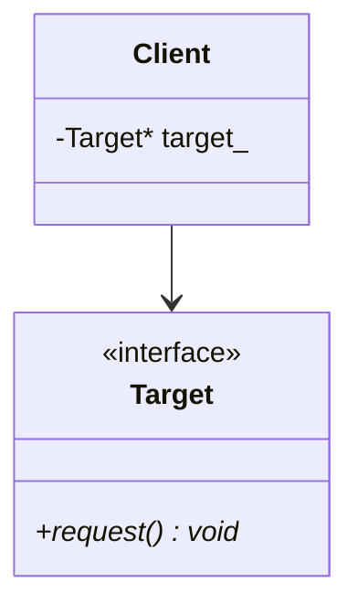

# Adapter Design Pattern

> **Category**: Structural Pattern

---

## 1. Intent
Converts the interface of a class into another interface clients expect. Allows incompatible classes to work together.

---

## 2. Architecture & UML

---

## 3. Modern C++ Implementation Notes
- Store wrapped objects using `std::unique_ptr<Component>` for exclusive ownership.
- Use `const &` or non-owning raw pointers for non-owning structural references.
