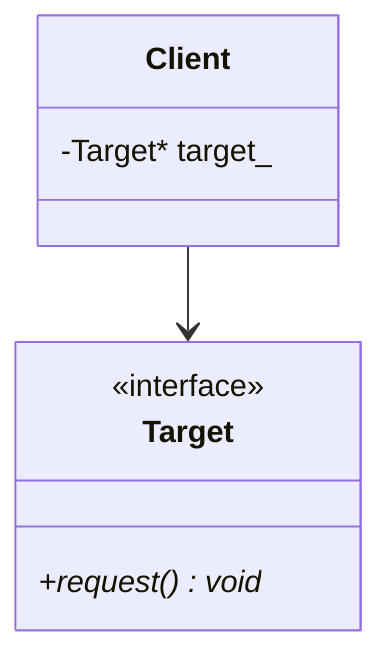

# Composite Design Pattern

> **Category**: Structural Pattern

---

## 1. Intent
Composes objects into tree structures to represent part-whole hierarchies. Enables uniform treatment of individual items and collections.

---

## 2. Architecture & UML

---

## 3. Modern C++ Implementation Notes
- Store wrapped objects using `std::unique_ptr<Component>` for exclusive ownership.
- Use `const &` or non-owning raw pointers for non-owning structural references.
