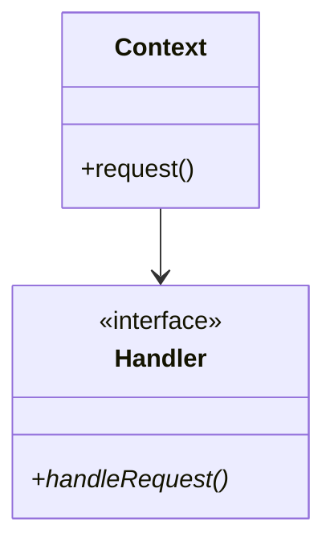

# Iterator Design Pattern

> **Category**: Behavioral Pattern

---

## 1. Intent
Provides a way to access the elements of an aggregate object sequentially without exposing its underlying representation (compatible with STL std::iterator_traits).

---

## 2. Architecture & UML

---

## 3. Modern C++ Best Practices
- Prefer `std::function` or lambdas for simple callbacks instead of complex class hierarchies.
- Use `std::weak_ptr` for observer lists to prevent memory leaks and dangling circular references.
