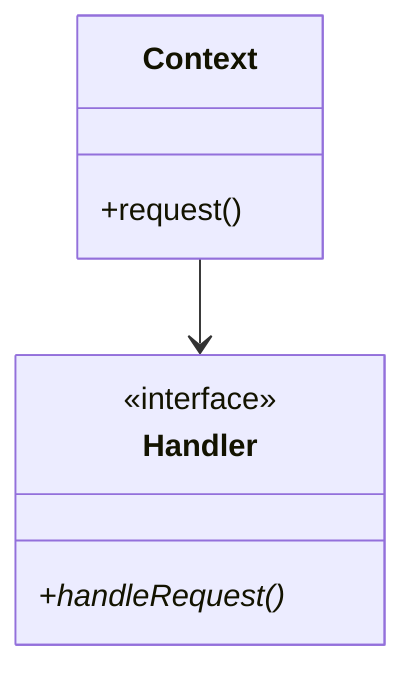

# Observer Design Pattern

> **Category**: Behavioral Pattern

---

## 1. Intent
Defines a one-to-many dependency between objects so that when one object changes state, all its dependents are notified automatically.

---

## 2. Architecture & UML

---

## 3. Modern C++ Best Practices
- Prefer `std::function` or lambdas for simple callbacks instead of complex class hierarchies.
- Use `std::weak_ptr` for observer lists to prevent memory leaks and dangling circular references.
