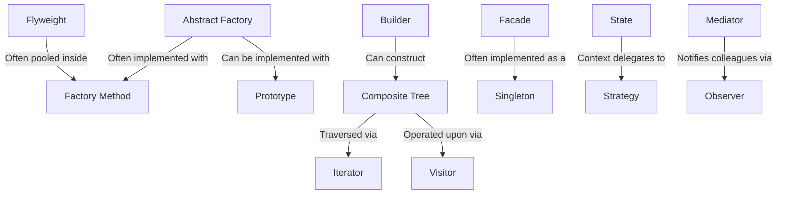

# How Design Patterns Compose Together

Design patterns are rarely used in isolation. In production systems and LLD case studies, they compose synergistically:

---

## Classic Real-World Compositions

1. **Vending Machine**: **State Pattern** (manages coin/item states) + **Command Pattern** (encapsulates dispensing actions) + **Observer Pattern** (notifies display UI).
2. **Parking Lot**: **Factory Method** (creates vehicles/spots) + **Strategy Pattern** (spot allocation & fee calculation) + **Meyers Singleton** (coordinates active lot state).
3. **Notification System**: **Factory Method** (instantiates channel clients) + **Strategy** (channel routing) + **Decorator** (retry with exponential backoff & rate limiting).
