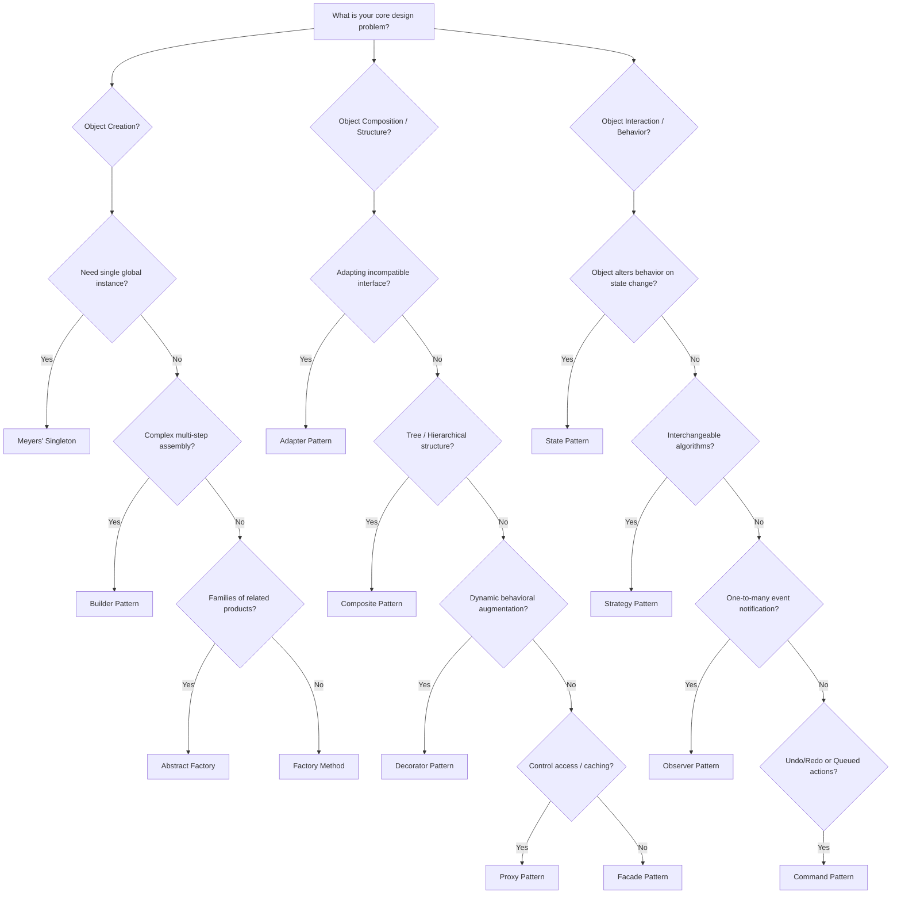

# Pattern Selection Guide & Decision Trees

Choosing the right design pattern is about recognizing **the fundamental design tension** in your problem statement.

---

## 🧭 The Master Pattern Decision Flowchart

---

## Documents in This Section

- [`Pattern-Decision-Tree.md`](Pattern-Decision-Tree.md): Exhaustive decision tree mapping requirements to patterns.
- [`Problem-To-Pattern-Mapping.md`](Problem-To-Pattern-Mapping.md): Symptoms & code smells mapped to target patterns.
- [`Pattern-Relationships.md`](Pattern-Relationships.md): How patterns compose (e.g. Abstract Factory implemented via Factory Method or Prototype).
- [`Design-Tradeoffs.md`](Design-Tradeoffs.md): Memory, performance, and cognitive load trade-offs.
- [`When-Not-To-Use-Patterns.md`](When-Not-To-Use-Patterns.md): Overengineering antipatterns and YAGNI.
- [`Common-Anti-Patterns.md`](Common-Anti-Patterns.md): God Class, Anemic Domain Model, Golden Hammer, Lava Flow.

