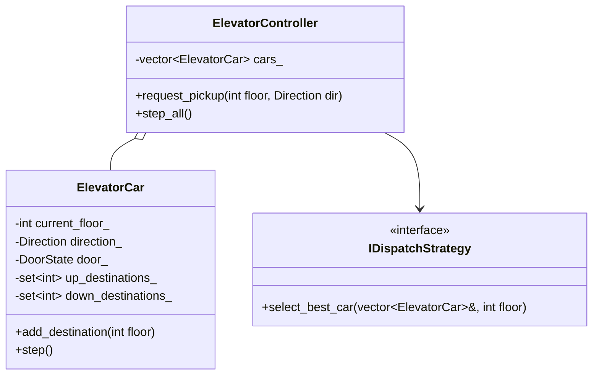

# Case Study 02: Elevator Management System

> **Difficulty**: Medium | **Primary Patterns**: State, Strategy, Dispatcher / Command | **Concurrency**: High

---

## 1. System Overview
Design a multi-car elevator control system optimizing passenger wait times using LOOK/SCAN dispatch scheduling algorithms, handling internal car requests and external floor summons across $N$ floors.



---

## 2. Requirements & Invariants
- **Functional**:
  1. Multiple cars operating independently in a building of $N$ floors.
  2. Hall calls (external button on floor with UP/DOWN direction).
  3. Car calls (internal buttons inside elevator selecting target floor).
  4. Door control (doors open only when stationary at a floor).
- **Non-Functional**:
  - Thread safety: Multiple passengers calling elevators concurrently.
  - Starvation prevention: Elevator finishes current sweep before reversing direction (SCAN/LOOK algorithm).

---

## 3. Design Patterns Applied
1. **State Pattern**: Encapsulates `IdleState`, `MovingUpState`, `MovingDownState`, and `DoorsOpenState`.
2. **Strategy Pattern**: Pluggable dispatch algorithms (Nearest Car First vs SCAN/LOOK Elevator Algorithm).

---

## 4. Build and Test
```bash
clang++ -std=c++17 -Wall -Wextra src/solution.cpp -o elevator_demo && ./elevator_demo
clang++ -std=c++17 -Wall -Wextra tests/test_elevator.cpp -o test_elevator && ./test_elevator
```
