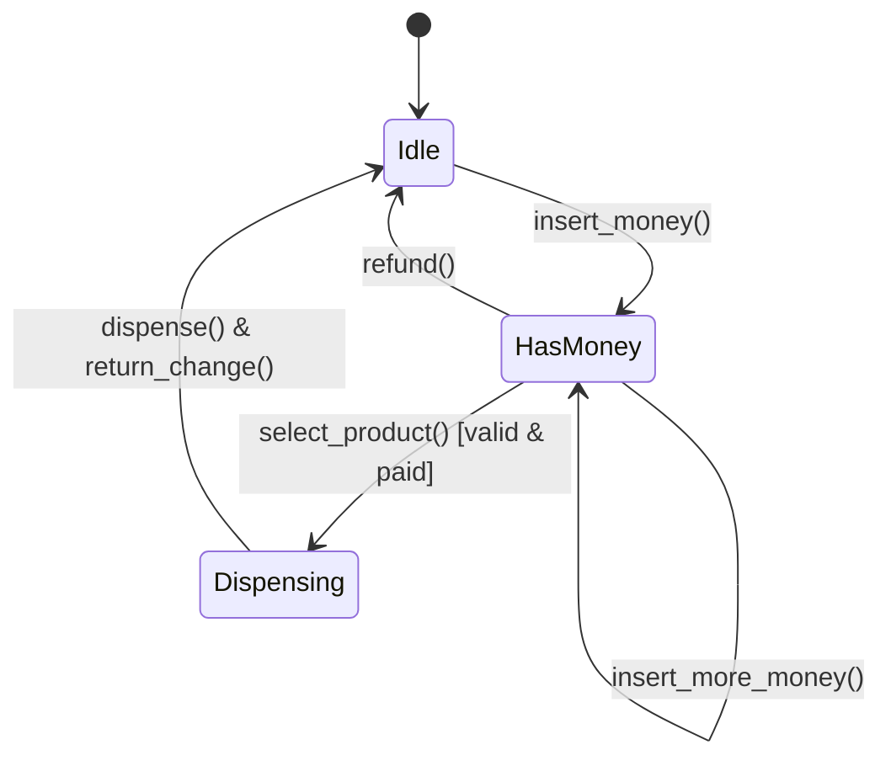

# Case Study 03: Vending Machine System

> **Difficulty**: Easy-Medium | **Primary Patterns**: State, Inventory Manager | **Concurrency**: Mutex Synchronization

---

## 1. System Overview
Design a self-service automated vending machine that accepts multiple currency denominations, manages product inventories in rack slots, validates funds, dispenses products, and returns exact change.



---

## 2. Core Entities & State Machine
- `IdleState`: Awaiting customer coin/card insertion.
- `HasMoneyState`: Balance registered; allowing product selection or transaction cancellation.
- `DispensingState`: Releasing product item, updating stock count, returning change.
- `SoldOutState`: Notifying user if selected rack is depleted.

---

## 3. Build and Test
```bash
clang++ -std=c++17 -Wall -Wextra src/solution.cpp -o vending_demo && ./vending_demo
clang++ -std=c++17 -Wall -Wextra tests/test_vending.cpp -o test_vending && ./test_vending
```
