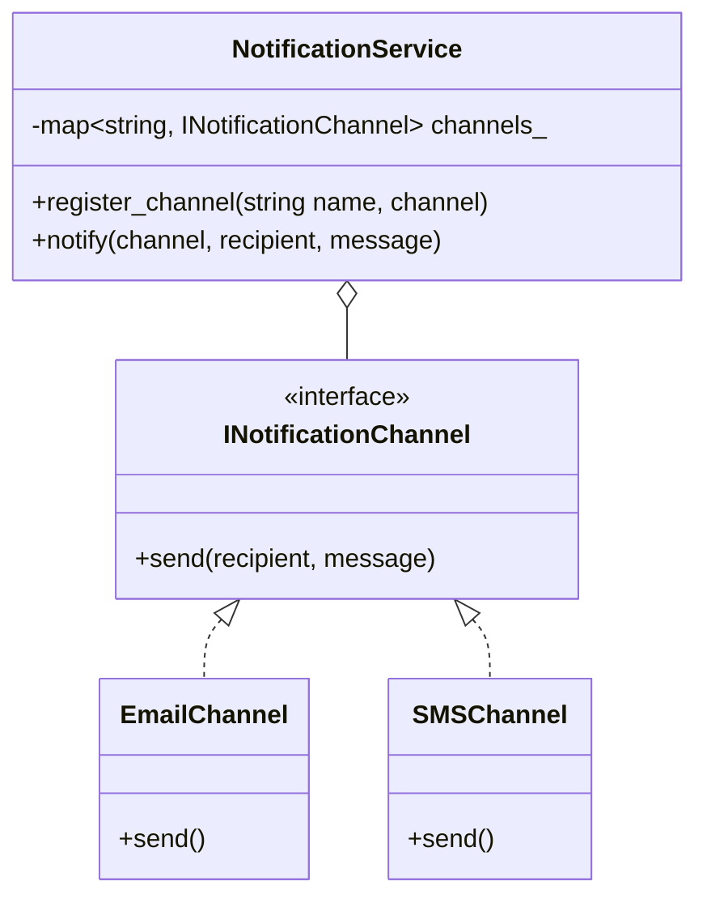

# Case Study 04: Notification Service Platform

> **Difficulty**: Medium | **Primary Patterns**: Strategy, Factory, Observer, Rate Limiter | **Concurrency**: Thread-Safe Pipeline

---

## 1. System Overview
Design an omnichannel notification dispatch engine capable of sending transactional and marketing alerts across multiple communication channels (Email, SMS, Push Notification, Webhook) with user preference filtering and rate limiting.



---

## 2. Build and Test
```bash
clang++ -std=c++17 -Wall -Wextra src/solution.cpp -o notification_demo && ./notification_demo
clang++ -std=c++17 -Wall -Wextra tests/test_notification.cpp -o test_notification && ./test_notification
```
