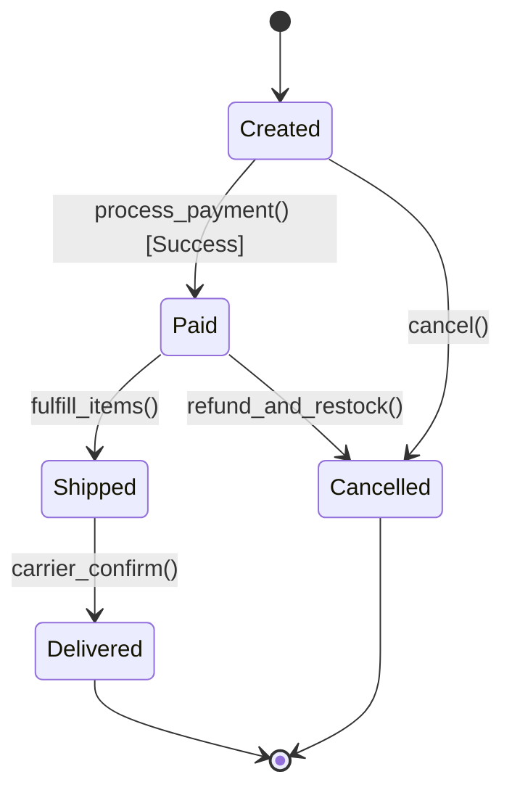

# Case Study 05: Order & Inventory Management System (OMS)

> **Difficulty**: Medium | **Primary Patterns**: State, Strategy (Payment), Command | **Concurrency**: Pessimistic Locking

---

## 1. System Overview
Design an end-to-end e-commerce order management system that coordinates inventory reservation, payment processing via interchangeable gateways, invoice generation, shipment tracking, and cancellation rollbacks.



---

## 2. Build and Test
```bash
clang++ -std=c++17 -Wall -Wextra src/solution.cpp -o order_demo && ./order_demo
clang++ -std=c++17 -Wall -Wextra tests/test_order.cpp -o test_order && ./test_order
```
