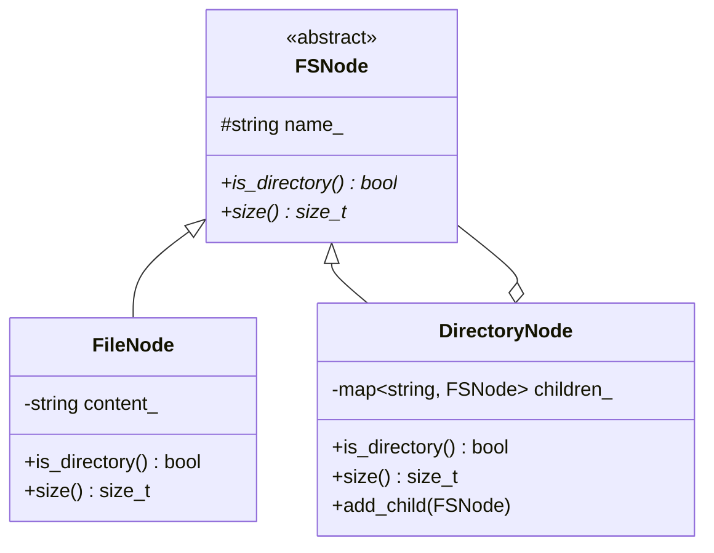

# Case Study 06: In-Memory File System

> **Difficulty**: Hard | **Primary Patterns**: Composite, Iterator, Proxy | **Concurrency**: Reader-Writer Locks

---

## 1. System Overview
Design an in-memory hierarchical Unix-like file system supporting directories, files, path resolution (`/usr/local/bin`), metadata tracking, recursive directory sizing, and thread-safe concurrent reads and writes (`std::shared_mutex`).



---

## 2. Build and Test
```bash
clang++ -std=c++17 -Wall -Wextra src/solution.cpp -o fs_demo && ./fs_demo
clang++ -std=c++17 -Wall -Wextra tests/test_fs.cpp -o test_fs && ./test_fs
```
