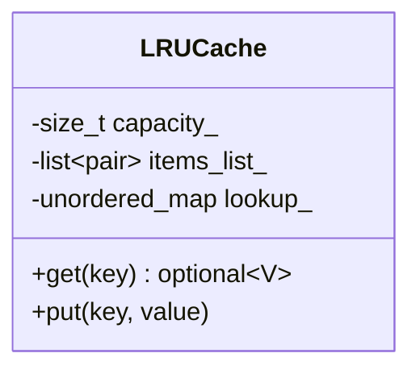

# Case Study 07: In-Memory Cache (LRU & LFU with TTL)

> **Difficulty**: Hard | **Primary Patterns**: Strategy (Eviction), Doubly-Linked List + Hash Map | **Concurrency**: `std::shared_mutex`

---

## 1. System Overview
Design an enterprise in-memory cache supporting $O(1)$ `get()` and `put()` operations, configurable maximum capacity, thread-safe reader-writer synchronization, and pluggable eviction strategies (Least Recently Used vs Least Frequently Used).



---

## 2. Build and Test
```bash
clang++ -std=c++17 -Wall -Wextra src/solution.cpp -o cache_demo && ./cache_demo
clang++ -std=c++17 -Wall -Wextra tests/test_cache.cpp -o test_cache && ./test_cache
```
