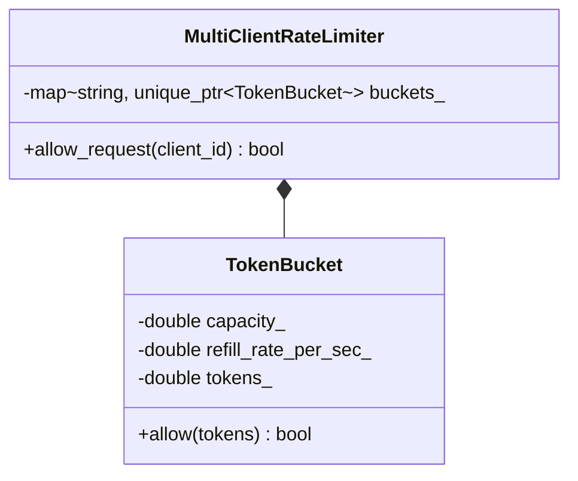

# Case Study 08: API Rate Limiter Middleware

> **Difficulty**: Medium | **Primary Patterns**: Strategy, Decorator / Interceptor | **Concurrency**: Atomic & Mutex Protection

---

## 1. System Overview
Design a distributed or multi-threaded API rate limiter protecting backend services from traffic spikes and DoS attacks. Supports Token Bucket and Sliding Window algorithms with per-client token buckets.



---

## 2. Build and Test
```bash
clang++ -std=c++17 -Wall -Wextra src/solution.cpp -o rate_limiter_demo && ./rate_limiter_demo
clang++ -std=c++17 -Wall -Wextra tests/test_rate_limiter.cpp -o test_rate_limiter && ./test_rate_limiter
```
