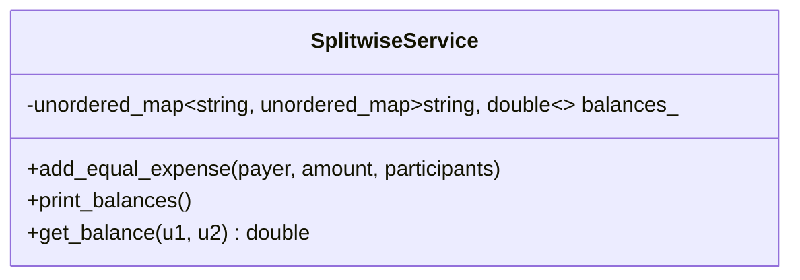

# Case Study 09: Splitwise Expense Sharing Application

> **Difficulty**: Medium | **Primary Patterns**: Strategy (Split Type), Observer, Graph Simplification | **Concurrency**: Mutex

---

## 1. System Overview
Design an expense tracking and bill splitting application allowing users to create groups, record shared expenses (EQUAL, EXACT, PERCENTAGE), maintain running balances, and compute the minimal cash settlement transactions between users.



---

## 2. Build and Test
```bash
clang++ -std=c++17 -Wall -Wextra src/solution.cpp -o splitwise_demo && ./splitwise_demo
clang++ -std=c++17 -Wall -Wextra tests/test_splitwise.cpp -o test_splitwise && ./test_splitwise
```
