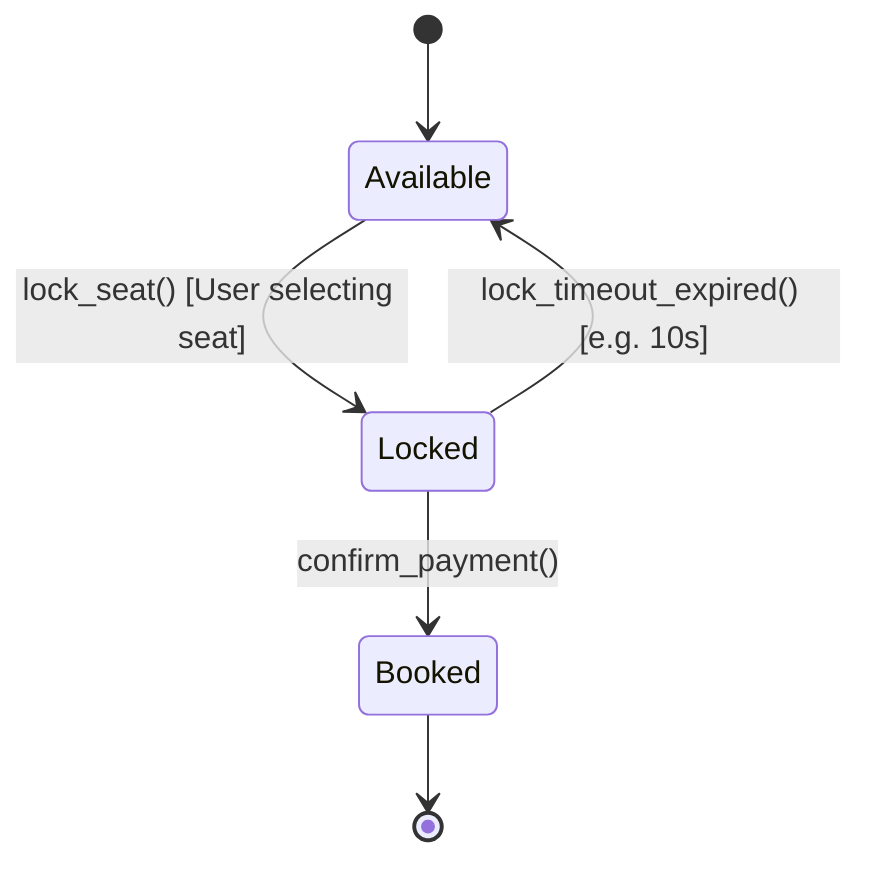

# Case Study 10: Movie Ticket Booking System (BookMyShow)

> **Difficulty**: Hard | **Primary Patterns**: State, Factory, Concurrency Lock Manager | **Concurrency**: Pessimistic Temporary Seat Locks

---

## 1. System Overview
Design a high-concurrency movie cinema reservation system. Prevents double-booking during peak ticket release events by employing temporary seat locking with automatic lease expiration timers.



---

## 2. Build and Test
```bash
clang++ -std=c++17 -Wall -Wextra src/solution.cpp -o movie_demo && ./movie_demo
clang++ -std=c++17 -Wall -Wextra tests/test_movie.cpp -o test_movie && ./test_movie
```
