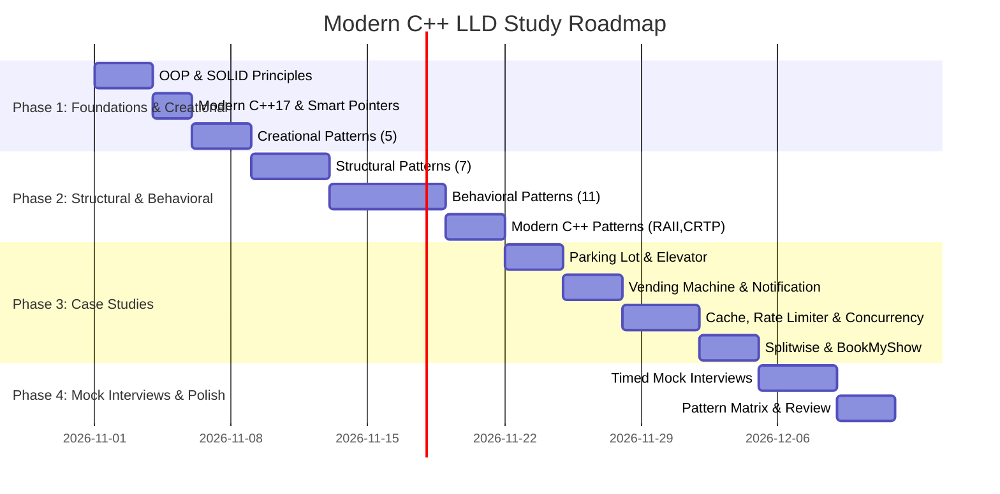

# Low-Level Design & C++ Mastery Roadmap

A structured timeline to transition from basic OOP knowledge to passing LLD rounds at top tech companies.

---

## 📅 4-Week Milestone Timeline

---

## 🎯 Phase Breakdown

### Phase 1: Foundations & The Creational Family
- **Milestone 1.1**: Understand object ownership: when to use `std::unique_ptr` vs `std::shared_ptr` vs raw non-owning pointers/references.
- **Milestone 1.2**: Master all 5 SOLID principles with the exact subtyping rules for Liskov Substitution Principle (preconditions cannot be strengthened, postconditions cannot be weakened).
- **Milestone 1.3**: Implement the 5 creational patterns (Singleton, Factory Method, Abstract Factory, Builder, Prototype). Emphasize Scott Meyers' thread-safe Singleton and Fluent/Step Builder.

### Phase 2: Structural, Behavioral, and Modern Idioms
- **Milestone 2.1**: Implement the 7 structural patterns. Contrast Object Adapter vs Class Adapter, and understand the difference between Proxy, Decorator, and Adapter.
- **Milestone 2.2**: Implement the 11 behavioral patterns. Master State (FSM) vs Strategy, Observer (thread-safe publish/subscribe), and Command (Undo/Redo).
- **Milestone 2.3**: Learn modern C++ idioms: RAII, PImpl (compilation firewalls), CRTP (compile-time polymorphism), and Type Erasure.

### Phase 3: Real-World Case Studies (Machine Coding)
- **Milestone 3.1**: Design and code state-machine-driven systems (Vending Machine, Elevator System).
- **Milestone 3.2**: Design and code hierarchical/tree systems (In-Memory File System).
- **Milestone 3.3**: Design and code high-concurrency systems (Thread-safe LRU Cache with read-write locks, Rate Limiter with Token Bucket, Seat-locking BookMyShow).
- **Milestone 3.4**: Design complex algorithmic business systems (Splitwise debt simplification graph algorithm).

### Phase 4: Interview Mastery & Speed
- **Milestone 4.1**: Practice solving arbitrary problem statements using the 6-step LLD Interview Blueprint in under 45 minutes.
- **Milestone 4.2**: Complete all flashcards and 1-page summaries in the Revision Center.

