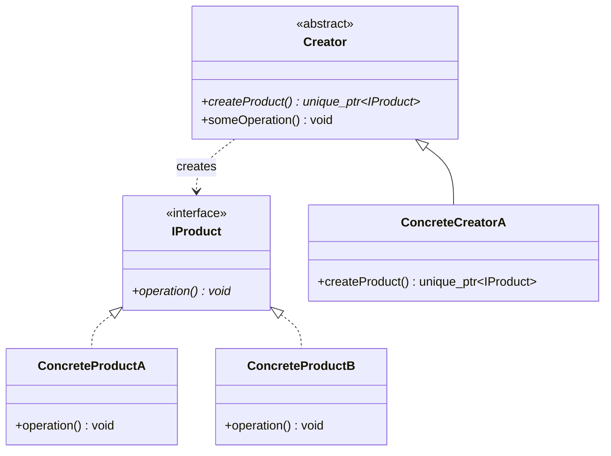

# [Pattern Name] Design Pattern

> **Classification**: [Creational / Structural / Behavioral] | **Scope**: [Object / Class]

---

## 1. Intent & Real-World Motivation

[Explain what real-world engineering problem this pattern solves in 2-3 concise paragraphs. Use an everyday non-software analogy.]

---

## 2. Naive Approach (Code Smell & Failure Modes)

### The Problem
[Explain why writing naive code without this pattern leads to maintenance nightmares, violation of SOLID, or tight coupling.]

```cpp
// Bad naive code snippet
```

### Why It Fails
- **Violation of OCP**: [Explain]
- **Tight Coupling**: [Explain]
- **Lack of Extensibility**: [Explain]

---

## 3. Architecture & UML



---

## 4. Modern C++ Refactoring

[Explain how `std::unique_ptr`, move semantics, and interfaces eliminate memory leaks and guarantee single ownership.]

---

## 5. Classic GoF vs Modern C++ Idiom

| Aspect | Classic GoF (C++98) | Modern C++ (C++17/20) |
|---|---|---|
| **Memory Management** | Raw pointers (`Product*`), manual `delete` | `std::unique_ptr<Product>`, zero leaks |
| **Polymorphism** | Dynamic virtual dispatch (vtable) | Dynamic or static (`std::variant`, templates, CRTP) |
| **Interfaces** | Abstract base class | Pure virtual with `= default` virtual destructor |

---

## 6. Trade-offs & When NOT to Use

- **Advantages**:
  - [Benefit 1]
  - [Benefit 2]
- **Disadvantages**:
  - [Trade-off 1]
- **When NOT to use**:
  - [Condition where simple code is better]

---

## 7. Interview Traps & Follow-Up Questions

1. **Q: [Common interview question]?**
   - **A**: [Concise, technically rigorous answer].
2. **Q: [Thread safety follow-up]?**
   - **A**: [Concurrency considerations].

